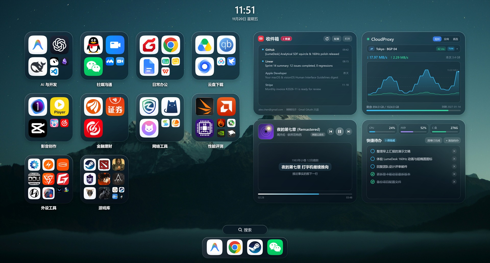
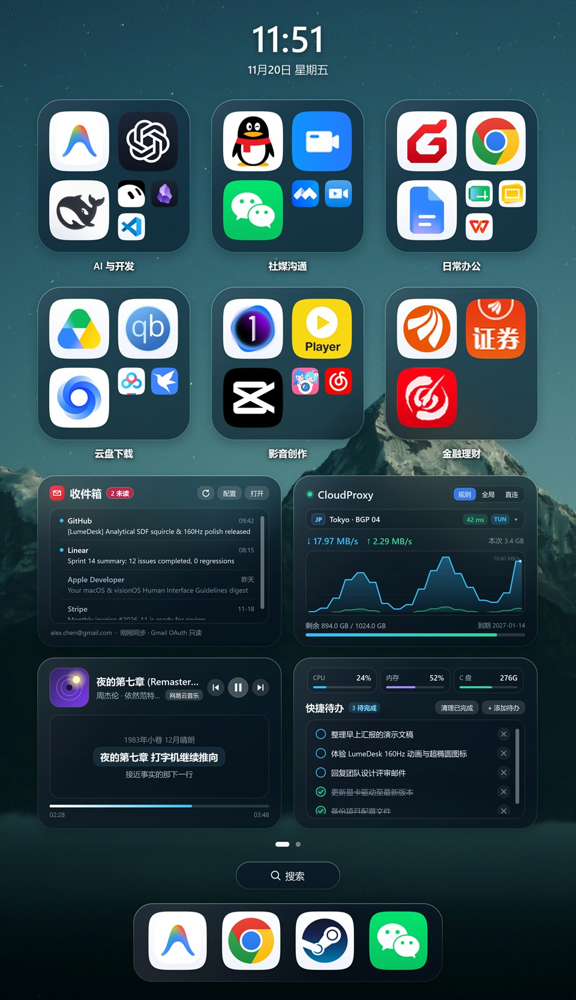
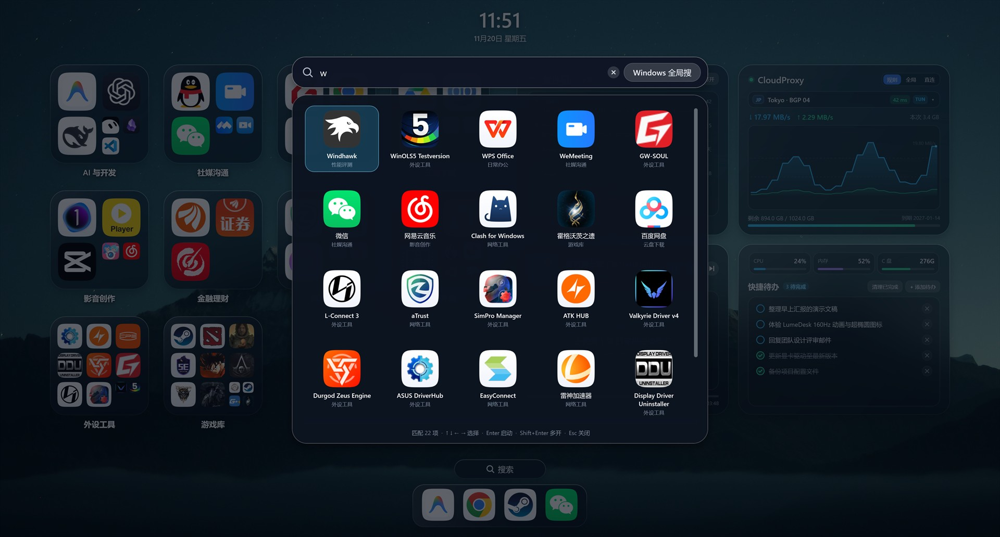
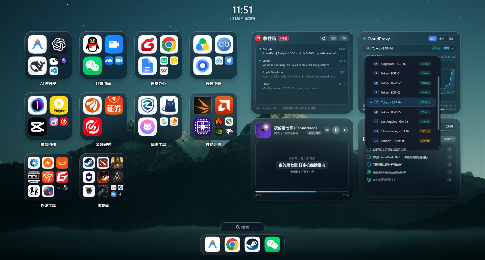

<div align="center">

# LumeDesk

**横竖屏自适应 · 零依赖 · 4K / 160Hz 原生磨砂大文件夹与桌面小部件启动台**

*An ultra-lightweight (~330 KB), zero-dependency frosted-glass desktop launcher & live widget deck for Windows 10 / 11 — automatically adapting to Landscape, Portrait, 1080p, 2K, 4K & mixed-DPI displays.*

[](https://github.com/LiWithDream/LumeDesk/releases)
[-0ea5e9)](#快速开始)
[](#方式二从源码-2-秒编译无需-vs--net-sdk)
[](LICENSE)

<br />



</div>

---

## 核心特性

### 1. 横竖屏与多分辨率原生自适应
- **横屏 / 竖屏自动切换**：根据目标屏幕宽高比自动在 **横屏双栏工作台**（左侧大文件夹网格 + 右侧 2×2 小部件区 + 底部毛玻璃 Dock 胶囊）与 **竖屏手机式主页**（顶部文件夹 + 中部小部件 + 底部胶囊 Dock）之间无缝切换。
- **全分辨率 & Per-Monitor DPI v2**：内置 `PerMonitorV2` 清单与混合 DPI 适配，从 1080p 笔记本、2K/4K 横屏、带鱼屏到 4K 竖屏副屏均可自适应缩放，并监听系统分辨率/缩放变更与旋转热重排。
- **智能大文件夹宫格与分页**：单夹 `≤ 7` 项展示经典 **2×2 四宫格**（3 大图标直达 + 右下角 2×2 子格），超过 7 项自动切换 **3×3 九宫格**，超出单页自动平滑分页（滚轮 / 方向键 / 页面指示点），也可右键自定义网格密度与单卡形态。

### 2. 解析式超椭圆图标抗锯齿 & 160Hz 丝滑 GPU 动效
- **告别图标锯齿毛刺**：在 **512×512** 超采样画布上以梯度归一化解析超椭圆 SDF（`|u|^4.6 + |v|^4.6 = 1`）直接输出原生 GPU 预乘 **`Pbgra32`**，配合边界色外延（自动消除自带圆角/柔边图标的双重弧边）与 WPF **`BitmapScalingMode.Fant`** 区域平均重采样，即使缩小至 2×2 迷你缩略格也丝滑锐利。
- **高刷 GPU 硬件加速**：采用 Direct3D SwapChain 原生渲染（零 `UpdateLayeredWindow` 回读开销），自动读取显示器原生刷新率（支持 60Hz–240Hz），全量冻结阴影特效，带来丝滑的 Dock 连续波形放大、弹窗展开与惯性滚动。

### 3. 直接拖拽排序 & 拼音模糊搜索
- **所见即所得拖拽排序**：在桌面大文件夹卡片、展开弹窗内均可直接用鼠标拖动图标即时调整顺序（支持滚屏边缘自动滚动），也可拖拽分类标题重排大文件夹顺序；支持直接将外部 `.lnk` / `.exe` / `.url` 拖入分类。
- **Spotlight 式快速搜索**：支持应用名、分类名、英文缩写及**中文拼音首字母**实时模糊检索（如输入 `wx` 匹配微信、`vsc` 匹配 VS Code），全键盘方向键导航，`Enter` 唤起、`Shift+Enter` 强制多开，一键跳转 Windows / Everything 全局搜。

### 4. 四大实时互动磨砂小部件 (`WidgetDeck`)
可在右键菜单或托盘独立开关每一张卡片：
- **📬 邮箱收件箱**：同时支持 **Google OAuth 2.0（Gmail API 永久只读授权）** 与 **标准 IMAP SSL（QQ / 163 / Gmail）**，凭据经 Windows DPAPI 本机加密；实时展示未读徽章与最新邮件列表，点击直达对应会话。
- **🌐 代理状态与实时网速**：原生对接 **Clash Verge Rev / Mihomo** Named Pipe（`\\.\pipe\verge-mihomo`），自动过滤订阅流量/到期等伪节点，支持一键切换 `规则 / 全局 / 直连` 与带延迟色标的可滚动节点切换弹窗（打开时自动将当前节点居中高亮），实时绘制双曲线网速与订阅余量；未运行代理时自动回退显示系统网卡实时网速。
- **🎵 音乐控制与实时同步歌词**：零额外依赖原生接入 Windows **SMTC**（YouTube Music / Spotify / Chrome / Edge / Apple Music 等），并内置 **网易云音乐** 窗口与歌词回退支持，实时展示圆角专辑封面、高亮歌词胶囊与进度条。
- **⚡ 系统监控与快捷待办**：实时监测 CPU / 内存 / C 盘余量，内置可勾选、一键清理已完成的轻量桌面待办。

### 5. 智能单实例唤起 & 零侵入文件管理
- **防重复多开**：点击微信（含 4.0 `Weixin.exe`）、QQ、Telegram、Obsidian、Steam、Clash Verge 等常驻软件时优先唤醒后台或托盘现有窗口；右键菜单随时保留 **「强制新开窗口启动 (多开)」**。
- **无损目录映射**：直接映射 `data\` 下的文件夹（自动隐藏 `01 · ` 排序前缀），绝不修改或删除你的原 Windows 桌面文件；贴合桌面底层，不占任务栏、不进 `Alt+Tab` 且兼容 `Win+D`。

---

## 更多界面预览

| 4K 竖屏主页 & 胶囊 Dock | Spotlight 拼音搜索 | Clash 节点切换弹窗 |
| :---: | :---: | :---: |
|  |  |  |

---

## 快速开始

### 方式一：直接下载开箱即用（推荐）
1. 前往 [**Releases 页面**](https://github.com/LiWithDream/LumeDesk/releases) 下载 `LumeDesk-v1.0.0-win-x64.zip` 并解压到本机固定目录（例如 `D:\LumeDesk`）。
2. 双击 **`QuickStart.bat`**（或直接运行 `LumeDesk.exe`）：
   - 首次启动会自动无损扫描当前电脑桌面的快捷方式并智能分类导入 `data\`（绝不删除原桌面文件）；
   - 自动识别当前主屏（横屏/竖屏均可）并启动。

### 方式二：从源码 2 秒编译（无需 VS / .NET SDK）
仅需 Windows 10 / 11 内置的 `.NET Framework 4.8`：

```powershell
# 1. 编译生成 dist\LumeDesk.exe（约 2 秒完成，支持 -Strict 零警告检查）
powershell -ExecutionPolicy Bypass -File .\build.ps1 -Strict

# 2. （可选）无损导入当前桌面快捷方式并智能分类（加 -NoCopy 仅创建空分类）
powershell -ExecutionPolicy Bypass -File .\setup_folders.ps1

# 3. 启动（或直接运行 build.ps1 -Run）
.\dist\LumeDesk.exe
```

---

## 日常交互速查

| 操作 | 方式 |
| :--- | :--- |
| **拖拽排序图标 / 分类** | 在文件夹卡片、弹窗内直接按住图标拖动；或拖拽分类标题调整顺序 |
| **唤起快速搜索** | 点击底部 `搜索` 胶囊、双击托盘图标，或桌面直接打字 |
| **开机自启动** | 右键系统托盘图标或桌面空白处 → 勾选「开机自动启动」 |
| **切换目标显示器** | 右键系统托盘图标 → `显示屏幕`（支持自动主屏 / 优先竖屏 / 指定物理屏） |
| **隐藏/恢复原生桌面图标** | 右键系统托盘图标 → 切换「显示/隐藏 Windows 原生桌面图标」 |
| **固定到 Dock / 切底色 / 多开** | 右键任意应用图标 |
| **行内重命名 / 新建分类** | 点击展开弹窗顶部的分类标题直接重命名，或右键桌面空白处新建 |
| **自定义高清图标** | 放入 `data\_Icons\<应用显示名>.png`，托盘点击「刷新图标与壁纸」 |
| **Gmail OAuth 2.0 永久只读授权** | 详见 [Gmail OAuth 2.0 配置指南](docs/GMAIL_OAUTH_SETUP.md) |

---

## 项目结构

```text
LumeDesk/
├── QuickStart.bat            # 双击开箱即用启动脚本（自动编译/检测 + 首次导入 + 启动）
├── build.ps1                 # 零依赖 .NET 4.8 编译脚本（支持 -Strict / -Run）
├── setup_folders.ps1         # 无损桌面快捷方式智能分类导入脚本
├── LumeDesk.manifest         # Per-Monitor DPI v2 应用清单
├── config.example.json       # 默认配置模板（无任何密钥）
├── docs/
│   ├── GMAIL_OAUTH_SETUP.md  # Gmail API OAuth 2.0 永久授权配置指南
│   └── images/               # README 演示截图
├── src/                      # 全部原生 C# 5.0 / WPF 源码（15 个模块）
│   ├── App.cs                # 入口、单实例锁、系统托盘菜单与离线预览模式
│   ├── ConfigManager.cs      # 原子化 JSON 配置持久化与大小写兼容
│   ├── MonitorHelper.cs      # 多屏枚举、Per-Monitor DPI v2 与原生刷新率探测
│   ├── DesktopAttachment.cs  # 桌面底层贴合、Win+D 免疫与开机自启管理
│   ├── WallpaperService.cs   # 1:1 壁纸裁切与三遍高斯模糊磨砂底图生成
│   ├── IconExtractor.cs      # 512×512 SDF 超椭圆抗锯齿与边界色外延引擎
│   ├── FolderScanner.cs      # data\ 目录扫描、排序、名称校验与首次自初始化
│   ├── SearchMatcher.cs      # 中英文、缩写与中文拼音首字母模糊检索引擎
│   ├── WindowActivator.cs    # 微信/QQ/Steam 等已运行窗口智能唤醒
│   ├── MainWindow.cs         # 横竖屏主网格、拖拽排序、弹窗、搜索与高刷动效引擎
│   ├── WidgetDeck.cs         # 四大磨砂桌面小部件 UI 与节点切换弹窗
│   ├── ImapMailService.cs    # Gmail API OAuth 2.0 + IMAP4 SSL 双模式后端
│   ├── ClashService.cs       # Mihomo Named Pipe 实时流量、伪节点过滤与节点控制
│   ├── MediaLyricsService.cs # 原生 Windows SMTC + 网易云回退与同步歌词服务
│   └── SystemStatsService.cs # CPU / 内存 / 磁盘 / 系统网卡回退速率采样
├── data/                     # 本地分类快捷方式目录（默认 .gitignore 忽略）
└── dist/                     # 编译产物目录（LumeDesk.exe + .config）
```

---

## 隐私与安全说明

- **零遥测、零统计**：除用户主动开启的邮箱同步（直连 Google / IMAP）、歌曲同步歌词匹配（`lrclib.net` / 网易云歌词接口）外，不发起任何外部网络请求。
- **本机 DPAPI 加密**：邮箱 OAuth Refresh Token、Client Secret 与 IMAP 密码均经 Windows `ProtectedData`（`CurrentUser`）加密保存于本地 `config.json`；`.gitignore` 默认排除 `config.json` 与 `data/*`。

---

## License

本项目基于 [MIT License](LICENSE) 开源。
